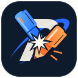

<p align="center">
  <a href="#how-to-play">
    
  </a>
</p>

<h1 align="center">Pen Fight Arena</h1>

<h3 align="center">A classroom classic, rebuilt in 3D.</h3>

<p align="center">
  Flick your pen, knock your opponent's off the desk, and see how the AI chooses its shots.
</p>

<p align="center">
  <a href="package.json"></a>
  <a href="package.json"></a>
  <a href="package.json"></a>
  <a href="package.json"></a>
  <a href="package.json"></a>
</p>

<p align="center">
  <a href="#getting-started"><strong>Get started</strong></a> &nbsp;·&nbsp;
  <a href="#how-to-play"><strong>How to play</strong></a> &nbsp;·&nbsp;
  <a href="#game-modes"><strong>Game modes</strong></a> &nbsp;·&nbsp;
  <a href="docs/architecture.md"><strong>Architecture</strong></a> &nbsp;·&nbsp;
  <a href="CONTRIBUTING.md"><strong>Contribute</strong></a>
</p>

---

Aim, flick, and knock your opponent's pen off the desk. Each turn is a small test of power, angle, and spin, and the round continues until a pen falls.

Play with a friend, challenge an AI opponent, or watch two algorithms face off. In Practice Lab, explore the AI's candidate shots and search tree, then request a hint for your own move.

<details>
<summary><strong>Explore the README</strong></summary>

- [Features](#features)
- [Game modes](#game-modes)
- [How to play](#how-to-play)
- [Controls and camera](#controls-and-camera)
- [Pen choices](#pen-choices)
- [AI Lab and benchmarks](#ai-lab-and-benchmarks)
- [AI algorithms](#ai-algorithms)
- [Getting started](#getting-started)
- [Configuration](#configuration)
- [Project structure](#project-structure)
- [Development checks](#development-checks)

</details>

## Features

| Feature                    | What you can do                                                                                            |
| -------------------------- | ---------------------------------------------------------------------------------------------------------- |
| **3D classroom**           | Play at a wooden desk with animated characters, a follow camera, and classroom ambience.                   |
| **Physics-based flicking** | Control direction and power by pulling back on your pen. Grab it off-centre to add spin.                   |
| **Pen selection**          | Choose from standard and Matador pen models with different physical properties and colour options.         |
| **AI Lab**                 | Inspect search trees, shot scores, evaluation counts, and algorithm-specific details.                      |
| **Algorithm benchmarks**   | Run headless AI matches and compare wins and average decision times.                                       |
| **Game settings**          | Adjust desk friction, graphics quality, table texture, sound, aim guides, replays, and impact slow motion. |

## Game modes

| Mode                | Description                                                                             |
| ------------------- | --------------------------------------------------------------------------------------- |
| **Two Players**     | Local pass-and-play matches with separate pen selections and player names.              |
| **Play vs AI**      | Challenge beginner, advanced, or expert opponents.                                      |
| **AI vs AI Battle** | Pick each opponent's algorithm and pen, then watch at 1×, 2×, or 4× speed. |
| **Practice Lab**    | Choose an opponent algorithm, keep the inspector open, and request hints on your turn.  |

### How to play

1. Choose a mode and select your pen.
2. Press on your pen, pull back to aim and set the power, then release to flick.
3. Try grabbing near either end of the barrel to change the spin.
4. Keep your pen on the desk while knocking your opponent's pen off.

The scoreboard shows the current round and, outside Practice Lab, the match target. If both pens fall during a shot, both players earn a point. Use the in-game menu to pause, resume, or return to mode selection. The opponent in human-vs-AI is labelled **AI**.

### Controls and camera

| Control                                | Action                                                                                             |
| -------------------------------------- | -------------------------------------------------------------------------------------------------- |
| Press, pull back, and release your pen | Aim and flick with a mouse, touch, or stylus.                                                      |
| Drag away from either pen              | Orbit the camera; areas near either pen are protected from accidental rotation.                    |
| Two-finger pinch or trackpad pinch     | Zoom between 50% and 200%. Trackpad zoom uses Ctrl+wheel in Chromium and gesture events in Safari. |
| Camera icon                            | Open Overview, Top, Side, Player, rotation, tilt, zoom, and Reset controls.                        |
| **Follow**                             | Track the active pen; manual camera changes turn Follow off.                                       |
| **Pin view** / **Pinned**              | Freeze the current camera view or unpin it.                                                        |
| **Esc**                                | Pause or resume a match; return from settings opened through the pause menu.                       |
| **L**                                  | Toggle the AI Lab during an unpaused match.                                                        |

While the camera is pinned, gestures, presets, zoom, Follow, and automatic replay/turn cameras cannot move it; pen aiming still works. Pause/settings retain the pin. Returning to the main menu or starting a new match clears it unless configured to start pinned. Switching away from the game also pauses the match automatically.

### Pen choices

Choose from **Ball Pen**, **Gel Pen**, **Matador High School**, **Matador Smoothy**, **Matador All Time**, and **Matador i-teen**. Matador models support custom colours; High School is the default selection. All Time supports matching custom colours on its cap and end parts; its researched product details and estimated game balance are documented in [pen physics](docs/pen-physics.md).

Play vs AI and Practice Lab give both players the same pen model with contrasting colours; AI Battle allows a separate model and colour for each side.

## AI Lab and benchmarks

Start Play vs AI, Practice Lab, or AI Battle, then select **Ai log** in the toolbar. Practice Lab and AI Battle open it automatically.

| Tab             | What it shows                                                                                                           |
| --------------- | ----------------------------------------------------------------------------------------------------------------------- |
| **Moves**       | Candidate shots and scores. In Practice Lab, select **Suggest my move** and then **Play suggestion** to execute a hint. |
| **Search tree** | The recorded search nodes and selected path.                                                                            |
| **Details**     | Algorithm-specific decision data.                                                                                       |
| **Benchmark**   | Headless algorithm comparisons using the real physics engine.                                                           |

For a benchmark, choose two algorithms, a round count, and an accuracy level, then select **Run headless matches**. Results show wins, average milliseconds per decision, average flicks, and knock-offs. **Stop** cancels the run; only completed rounds count.

Benchmarks alternate who flicks first, use Ball Pen against Gel Pen, and default to reduced search budgets configured in [`src/config/ai.ts`](src/config/ai.ts). They do not use the pen selections from the visible match. Rounds have no flick limit, so a stalled matchup can be stopped manually.

## AI algorithms

The game includes six algorithms, grouped by approach:

- **Uninformed search:** Depth-First Search (DFS).
- **Informed search:** Greedy Best-First Search and A*.
- **Adversarial and simulation search:** Minimax and Monte Carlo Tree Search (MCTS).
- **Rule-based control:** Fuzzy Logic.

Difficulty also affects execution noise and the chance of choosing a weaker shot. The default algorithms are fuzzy logic for beginner, A* for advanced, and MCTS for expert. Practice and AI battle modes let you select an algorithm directly.

AI Battle runs both selected algorithms with expert settings and no injected aiming noise or random mistakes. The 1×, 2×, and 4× controls scale pen playback. Character movement speeds up only slightly at higher settings. Automatic highlights and impact slow motion apply to modes with a human player.

<details>
<summary><strong>How the algorithms fit the game</strong></summary>

Search builds a shot from four choices: target, angle, power, and spin. Candidate shots are evaluated by the same physics engine used during play.

- **DFS** searches this four-level action tree and reports a cutoff if a configured depth limit prevents a complete shot.
- **Bidirectional search was removed:** discovering winning shots first made the later forward/backward prefix search redundant; dissipative game physics has no practical inverse transition.
- **A\*** uses shot effort as its path cost and simulated shot quality as its heuristic. The heuristic is not admissible, so this budgeted adaptation does not guarantee an optimal path.
- **Minimax** alternates MAX and MIN, choosing against worst-case replies within a root shortlist and depth limit.
- **MCTS** uses UCB selection, expansion, random rollouts, and backpropagation with a bounded action shortlist and rollout depth.
- **Fuzzy logic** uses distance, risk, and confidence to determine flick power and attack/defend balance.

See the [AI module guide](src/game/ai/README.md) for implementation details.

</details>

## Getting started

You need **Node.js 22.18 or newer**, npm, and a browser with WebGL support. No API keys or backend setup are required.

Clone the repository and install the locked dependencies:

```bash
git clone https://github.com/SABBIR-H0SSAIN/PenFight.git
cd PenFight
npm ci
npm run dev
```

If you already have a checkout, run the last two commands from its root. Open [localhost:3000](http://localhost:3000), or the address printed by Next.js if port 3000 is occupied.

For a production build:

```bash
npm run build
npm start
```

Player preferences and game settings are saved locally in the browser.

<details>
<summary><strong>Setup and playback tips</strong></summary>

- **Node version errors:** use Node.js 22.18 or newer. The repository's [`.nvmrc`](.nvmrc) selects Node.js 22 when using `nvm use`.
- **Blank or unavailable 3D view:** confirm WebGL is enabled in your browser. For a slow scene, choose **Low** graphics quality in Settings.
- **No sound:** interact with the menu to activate browser audio, then check Volume and Classroom ambience in Settings.
- **Changed defaults are not appearing:** saved browser preferences override configuration defaults. Clear this site's `pfa.settings` and `pfa.preferences` entries in browser local storage to reset them, then reload. This removes your saved choices.

</details>

### Configuration

Game defaults live in separate files under [`src/config/`](src/config/README.md): settings, preferences, matches, camera, input, physics, playback, AI, pens, audio, and graphics. [`config.ts`](src/config/config.ts) combines these sections into one validated configuration. Environment overrides are optional: copy [`.env.example`](.env.example) to `.env.local` and uncomment the values you need. See the [configuration guide](src/config/README.md) for JSON overrides, validation, and saved-preference precedence. Restart development or rebuild production after changing environment values.

## Project structure

```text
src/
├── app/                 Next.js routes, layout, and global styles
├── config/              Unified defaults and optional environment overrides
├── features/
│   ├── game/
│   │   ├── ui/          Menus, HUD, controls, dialogs, and game styles
│   │   └── runtime/     React provider and scene composition
│   ├── ai-lab/ui/       Inspector, search-tree drawing, and benchmark panels
│   ├── pen/             Pen catalogue, models, and selection UI
│   ├── character/       Character geometry, animation, and arm movement
│   ├── table/           Playable desk geometry and textures
│   ├── furniture/       Shared desk/chair geometry and bench materials
│   └── classroom/       Room, furniture, lighting, and background props
└── game/
    ├── ai/              Search strategies, evaluation, and headless matches
    ├── physics/         Collision, friction, rolling, and shot simulation
    ├── controller/      Match flow, input, and playback
    ├── state/           UI snapshots, preferences, and persistence
    ├── scene/           Three.js rendering and resource cleanup
    └── audio/           Recorded sound, movement audio, and ambience
```

The AI and physics modules run without React or a browser. React manages the interface and scene lifecycle; the controller updates pen and character transforms directly during animation frames. AI Lab loads on demand.

Browse the [documentation index](docs/README.md) for maintained guides and module references. For data flow, resource ownership, and extension points, see [Architecture](docs/architecture.md). Development conventions live in [Contributing](CONTRIBUTING.md).

## Development checks

Run the full check before submitting a change:

```bash
npm run check
```

This runs ESLint, TypeScript, the Node.js test suite, and a production build. Individual commands are also available:

| Command             | Purpose                                                       |
| ------------------- | ------------------------------------------------------------- |
| `npm run lint`      | Check source and test code with ESLint.                       |
| `npm run typecheck` | Check TypeScript contracts and components.                    |
| `npm test`          | Run simulation, search, geometry, state, and lifecycle tests. |
| `npm run build`     | Build the production application.                             |
| `npm run format`    | Format source, tests, and documentation with Prettier.        |

Tests cover physics, AI, controls, state, and scene behavior. See [Testing](docs/testing.md) for coverage and browser checks. For hand animation changes, run `npm run test:hand-motion` and consult the [hand-motion audit](docs/hand-motion-verification.md). [GitHub Actions](.github/workflows/ci.yml) runs `npm run check` on pushes and pull requests.

---

**See it in action:** Start a **Practice Lab** match to inspect the AI's candidate shots and search tree as you play. Use the **Benchmark** tab to compare algorithms under the same physics rules.
